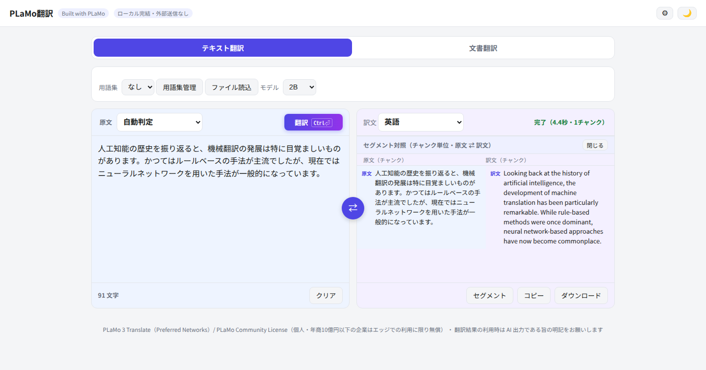
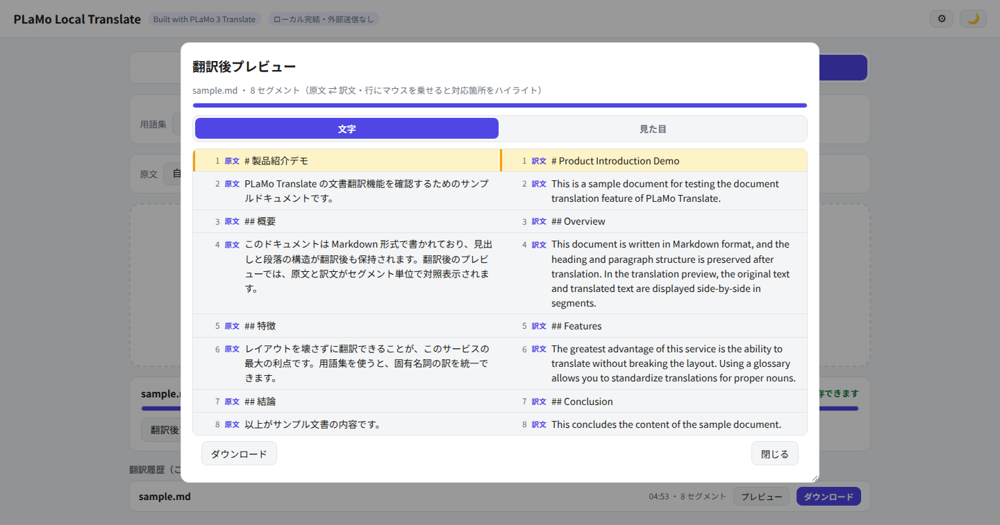
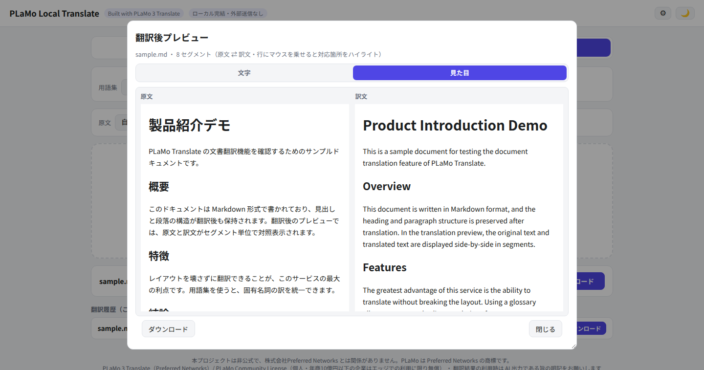
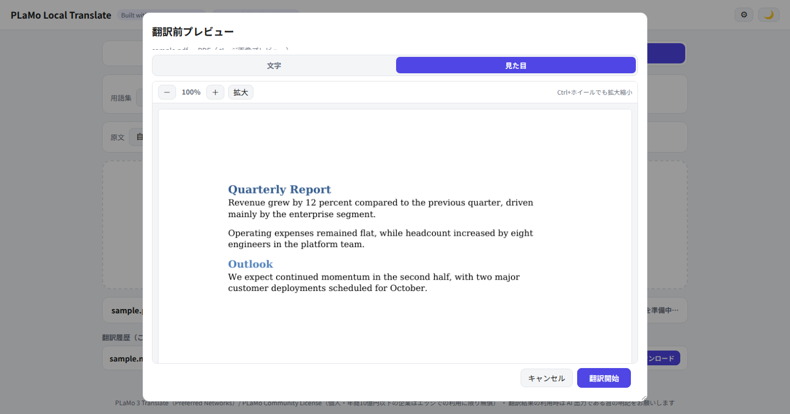
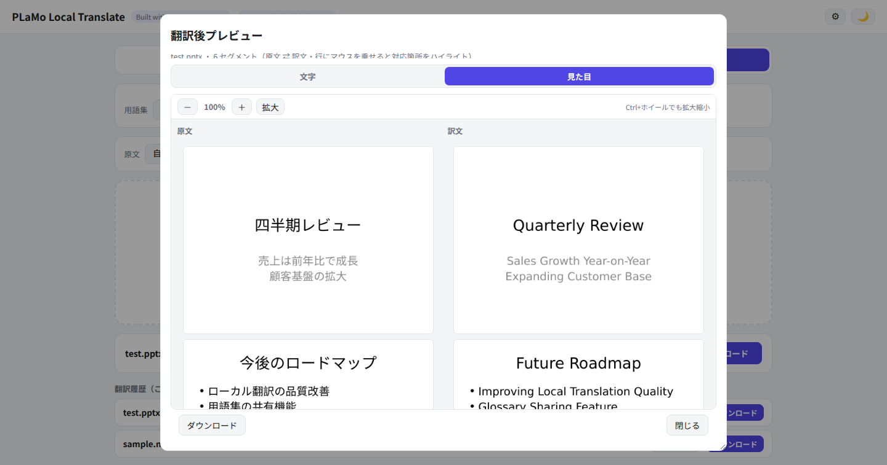
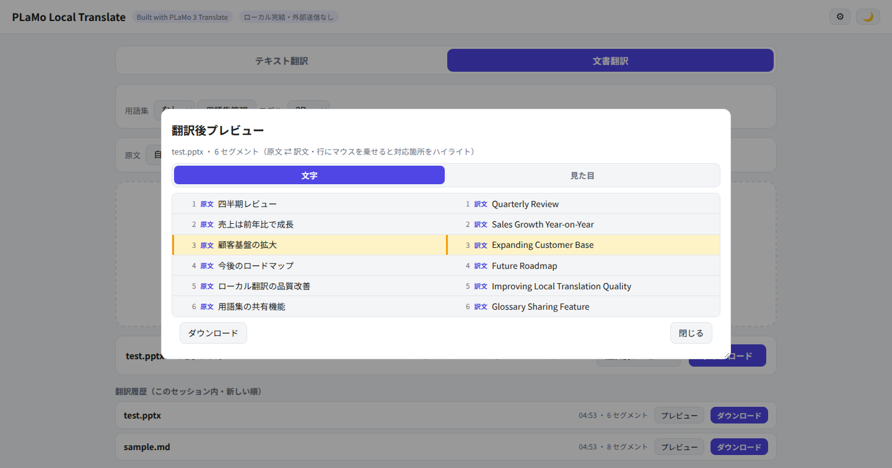
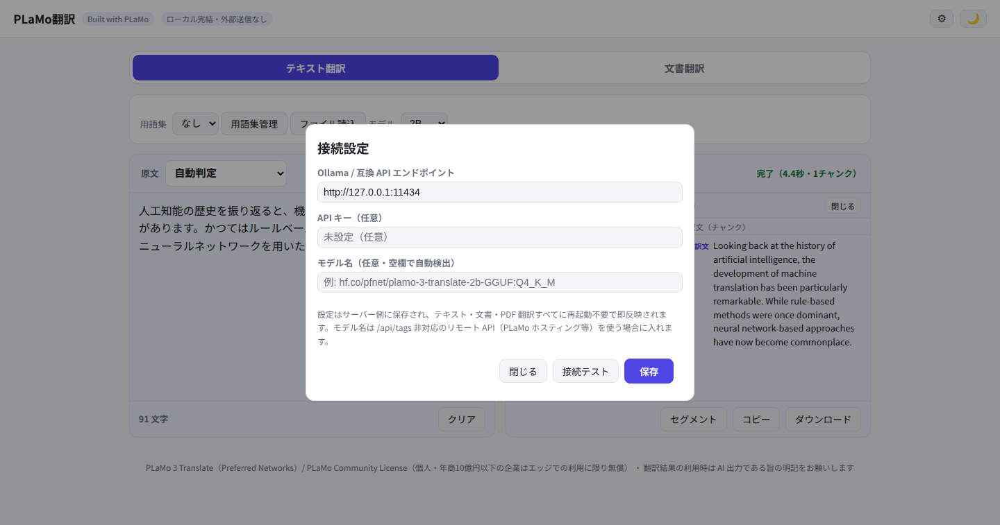

# PLaMo Local Translate

[日本語](README.md) | [English](README.en.md)

> ⚠️ This is an **unofficial** community project and is not affiliated with Preferred Networks, Inc. PLaMo / PLaMo 3 Translate are names (trademarks) of Preferred Networks.

A **translation service you install on your own machine and run fully locally**, built on [PLaMo 3 Translate](https://huggingface.co/pfnet/plamo-3-translate-2b-GGUF) (Preferred Networks) + Ollama (llama.cpp and LM Studio also work — see [Backend options](#backend-options)).
Its main focus is **layout-preserving document translation with a DeepL-style UI**: translate Office / PDF / Markdown / HTML documents while keeping the original formatting, with side-by-side original ⇄ translation previews. **No data ever leaves your machine unless you point it at a remote API yourself.**

---

## Features
| Area | Details |
|---|---|
| Text translation | 53 languages, HTML/Markdown tag preservation, chunked streaming for long inputs, sentence-level original ⇄ translation comparison in a full-width modal (bidirectional hover highlight) |
| Document translation | `.docx` / `.pptx` / `.xlsx` written back in-place preserving styles; `.pdf` via [BabelDOC](https://github.com/funstory-ai/BabelDOC) with layout preservation; `.md` / `.html` / `.txt` with delimiter-preserving reassembly |
| Visual preview | Before/after page-image comparison (LibreOffice + poppler) with zoom; pre-translation preview of extracted segments or PDF pages |
| Glossary | Multiple named glossaries, honorific/plain style control for Japanese output, language swap |
| Endpoint settings (⚙) | Change backend URL / API key / model from the WebUI — stored server-side in `data/config.json`, applied immediately without restart. Works with Ollama, llama.cpp (`llama-server`), LM Studio and remote OpenAI-compatible PLaMo hosting APIs |
| UX | Light/dark theme, mobile single-column, progress bars, in-session translation history |
| Lightweight | GGUF Q4_K_M weights are ~0.57 GB (0.8B) / ~1.8 GB (2B) — no dedicated GPU needed, runs comfortably on a normal laptop (see [Lightweight](#lightweight--runs-on-a-normal-laptop)) |

## Screenshots

| Text translation | Post-translation segment pairs |
|---|---|
|  |  |

| Visual before/after preview | PDF pre-translation preview |
|---|---|
|  |  |

| Office (PowerPoint) visual before/after preview | Office (PowerPoint) post-translation segment pairs (hover highlight) |
|---|---|
|  |  |

The two Office screenshots show a real Japanese PowerPoint (with a table) translated to English. Word / PowerPoint / Excel / PDF / Markdown / HTML all follow the same flow (drop → preview → translate → comparison / visual preview → download).

| Endpoint settings dialog (⚙) |
|---|
|  |

## Lightweight — runs on a normal laptop

The translation model, PLaMo 3 Translate, ships in four sizes (0.8B / 2B / 8B / 31B), and PFN officially states that the small models "run at high speed on smartphones, laptops and wearable devices with no network connection at all, delivering translations instantly" and that "high-quality translations are available at hand even without a large compute environment" ([official press release](https://www.preferred.jp/ja/news/pr20261105/); in PFN's comparative evaluation even the smallest model outscores existing translation-specialised LLMs).

- **Actual GGUF Q4_K_M file sizes (from Hugging Face)**: 0.8B ≈ 0.57 GB, 2B ≈ 1.8 GB. No dedicated GPU is required — on a recent laptop (CPU only, ~8 GB RAM) the 0.8B and 2B models are realistic choices
- **Reference: measured on our AMD Strix Halo machine (not a laptop)**: 0.8B ≈ 255 tok/s, 8B ≈ 26 tok/s (2B in between)

> We have not benchmarked on a laptop ourselves; every number above is labelled with its source. The default model is 2B (quality/speed balance); switch to 0.8B in ⚙ for the lightest footprint.

## Quick start

Ollama is the **recommended** backend; for llama.cpp / LM Studio see [Backend options](#backend-options).

```bash
# 1. Clone this repository
git clone https://github.com/keima-tech/plamo-local-translate.git
cd plamo-local-translate

# 2. Get the model (Ollama must be running)
ollama pull hf.co/pfnet/plamo-3-translate-2b-GGUF:Q4_K_M
# 8B / 0.8B variants are auto-detected too

# 3. Optional: configure via .env (or use the ⚙ dialog in the WebUI after start)
cp .env.example .env

# 4. Run
docker compose up -d --build
# open http://127.0.0.1:9130/
```

## Backend options

The app only calls an OpenAI-compatible `<URL>/v1/chat/completions`, so the backend can be switched from the ⚙ dialog **without restarting**.

| Backend | Model auto-detection | Explicit model name | API key |
|---|---|---|---|
| **Ollama** (recommended) | ✅ via `/api/tags` | not needed | not needed |
| **llama.cpp** (`llama-server`) | △ no `/api/tags`, so the app falls back to `/v1/models` (auto-detect works if the model name / `--alias` contains `plamo-3-translate`) | recommended | not needed |
| **LM Studio** (local server) | △ same fallback (**not verified on real hardware**) | required | not needed (any value if the server demands one) |

### Ollama (recommended, auto-detected)

```bash
ollama pull hf.co/pfnet/plamo-3-translate-2b-GGUF:Q4_K_M
# 8B / 0.8B variants are auto-detected too
```

Nothing to configure when Ollama runs on the same machine (the default endpoint is `http://127.0.0.1:11434`); for a remote Ollama just change the URL in ⚙.

### llama.cpp (llama-server)

Download the GGUF from Hugging Face and start `llama-server` (commands follow the [official model card](https://huggingface.co/pfnet/plamo-3-translate-2b-GGUF)):

```bash
# 1. Fetch the GGUF (Q4_K_M is the default pick; 0.8B/2B/8B/31B available)
hf download pfnet/plamo-3-translate-2b-GGUF --local-dir plamo-3-translate-2b-GGUF

# 2. Start the server (adjust -c context length, --port and --alias to taste)
llama-server -m plamo-3-translate-2b-GGUF/plamo-3-translate-2b-Q4_K_M.gguf \
  -c 16384 --port 8080 --alias plamo-3-translate --jinja --no-prefill-assistant
```

Then in the app's ⚙ dialog set the endpoint to `http://<host>:8080` and the model name to `plamo-3-translate` (the `--alias` value), and save.

- `llama-server` has no Ollama `/api/tags`, so the app falls back to `/v1/models` for the model list. Auto-detection works if the listed name contains `plamo-3-translate`, but **setting the model name explicitly is the safe choice**
- You need a **recent llama.cpp build with `plamo3` architecture support** — older builds fail to load the model with `unknown tokenizer: 'plamo3'` (measured example: Debian package b8681 failed, a self-built master succeeded). See the model card for details on `-c`, `--jinja` and other flags, which vary by hardware and build

### LM Studio

Start the local server in LM Studio (Developer tab; default `http://localhost:1234`, OpenAI-compatible). In the app's ⚙ dialog set the endpoint to `http://<host>:1234` and the model name to the identifier of the loaded model (e.g. `plamo-3-translate-2b`).

> **Note**: this path is **not verified on real hardware** — LM Studio does not normally run on Linux servers. The steps are based on the OpenAI compatibility (`/v1/chat/completions`, `/v1/models`) documented in the official model card.

## Configuration

| Source | Precedence | Notes |
|---|---|---|
| WebUI ⚙ dialog → `data/config.json` | highest | endpoint URL, API key, model override; hot-reloaded per request, no restart |
| `.env` / environment (`OLLAMA_URL`, `PORT`, `DATA_DIR`, `PDF_TIMEOUT_SECS`) | default | see `.env.example` |

- `GET /api/config` returns the masked view (`api_key_masked` = last 4 chars only — the key itself is never returned).
- `PUT /api/config` keeps an existing key when `api_key` is empty; `"__CLEAR__"` removes it.
- `POST /api/config/test` connection-tests the saved endpoint (`/api/tags` first, falling back to `/v1/models`) and lists detected models.
- If `model` is set, auto-detection is overridden — this is how you use a backend that has no `/api/tags` (llama.cpp, LM Studio, remote APIs).

## Security note

By default uvicorn binds to `127.0.0.1` — the app is designed for you alone on your own machine. The settings dialog has **no authentication**: anyone who can reach the app can change the endpoint (i.e. redirect translations to another model/server). If you share it with other devices on a LAN or make it reachable from a network you don't control, put Basic Auth (or similar) behind a reverse proxy in front of it. API keys are stored plaintext in `data/config.json` (mode `0600`) and only masked values are served by the API.

## Architecture

```
app/
  main.py            FastAPI backend (translate API, glossary, document translation,
                     BabelDOC shim, connection config API)
  doctrans.py        Office/md/html extraction & write-back
  static/index.html  single-file frontend (no external CDN)
tests/               pure-function & config API tests (run with plain pytest)
docker-compose.yml   host network; uvicorn binds 127.0.0.1:9130
Dockerfile           python:3.12-slim + LibreOffice + poppler + Noto CJK (~1.6 GB)
```

PDF translation runs BabelDOC as a subprocess against an in-app OpenAI-compatible shim, which rewrites its generic prompts into the `[plamo-translate]` format that PLaMo 3 Translate actually understands.

## Development

```bash
pip install fastapi httpx python-multipart markdown python-docx python-pptx openpyxl pytest
pytest tests/ -v
```

CI (GitHub Actions) runs these tests on every push/PR. The Docker image build is intentionally not run in CI (LibreOffice makes it slow and heavy); it is verified locally.

## License & model notice

- Code in this repository: **MIT** (see `LICENSE`).
- PLaMo 3 Translate model weights: **[PLaMo Community License](https://plamo.preferredai.jp/info/plamo-community-license-en)** — companies and individuals whose revenue or sales in their most recent fiscal year are JPY 1 billion or less may use the weights free of charge, commercial or non-commercial, on edge devices (smartphones, laptops, on-premises servers) without going through the cloud. Use beyond that scope (e.g. cloud-based offerings, or organisations above the revenue cap) requires a commercial license agreement with PFN. Download the weights from [Hugging Face](https://huggingface.co/pfnet/plamo-3-translate-2b-GGUF) under your own agreement with Preferred Networks.

## Known limitations
- Scanned-image PDFs are not OCR'd (text-based PDFs only)
- LibreOffice-based visual previews may differ slightly from the original renderer
- Sentence alignment in the text-translation comparison view is a display-only heuristic (chunks with mismatched sentence counts fall back to chunk-level rows; translation itself still runs per chunk). Document-translation comparison remains per segment
- Translation outputs are kept for 2 hours, then auto-deleted
