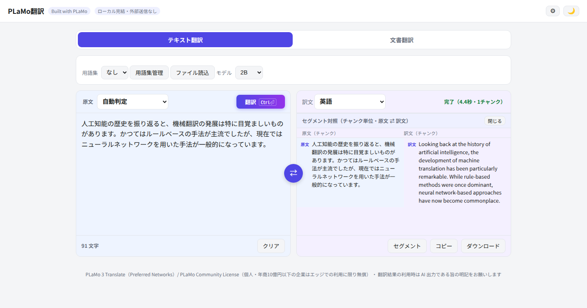
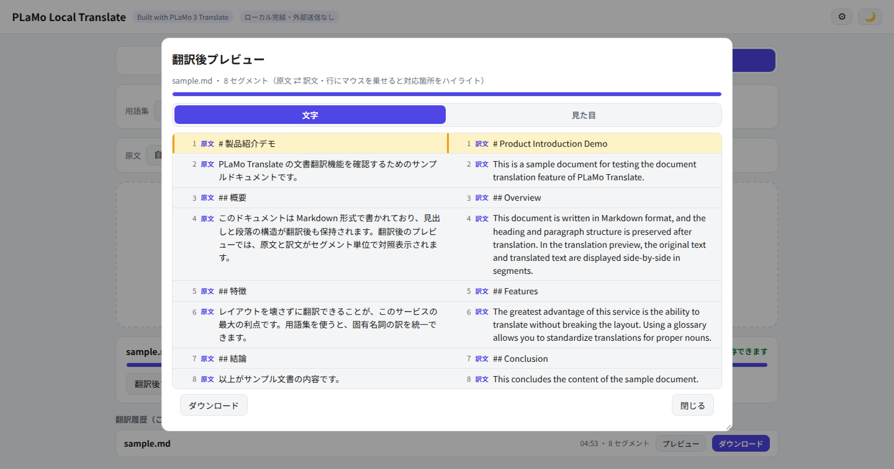
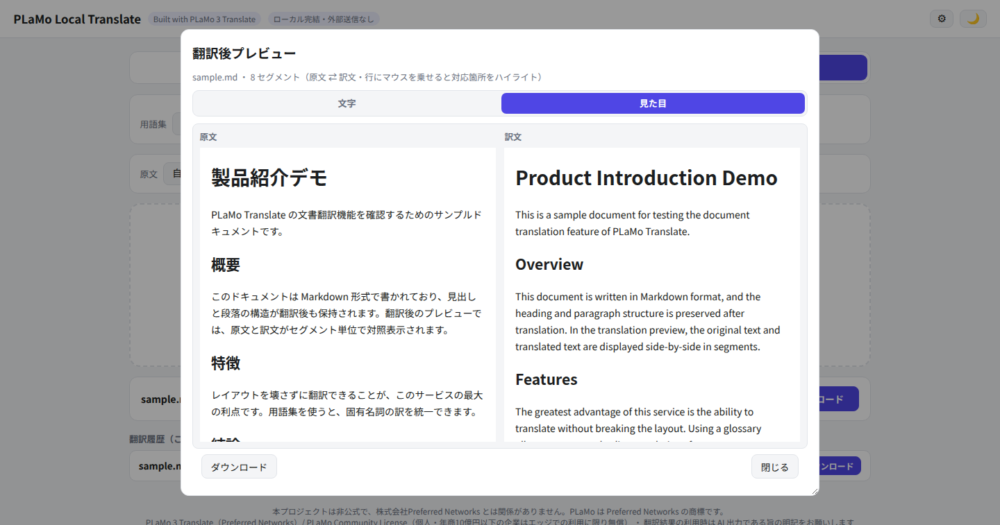
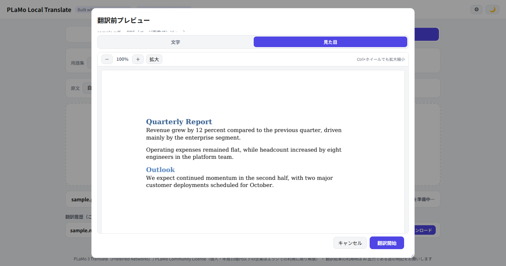
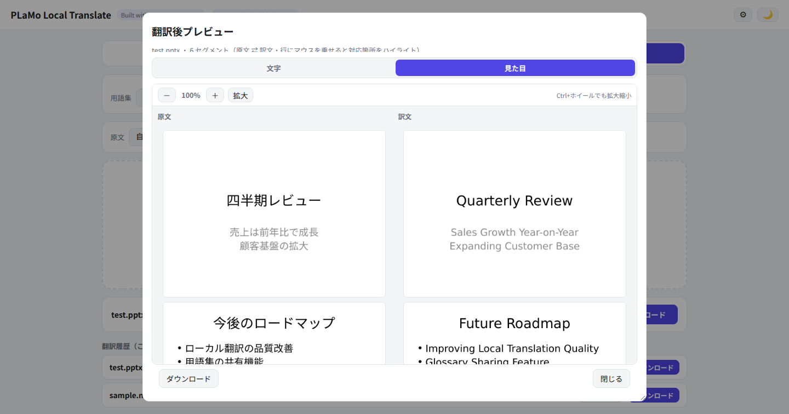
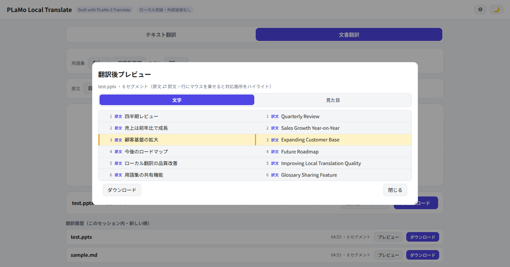
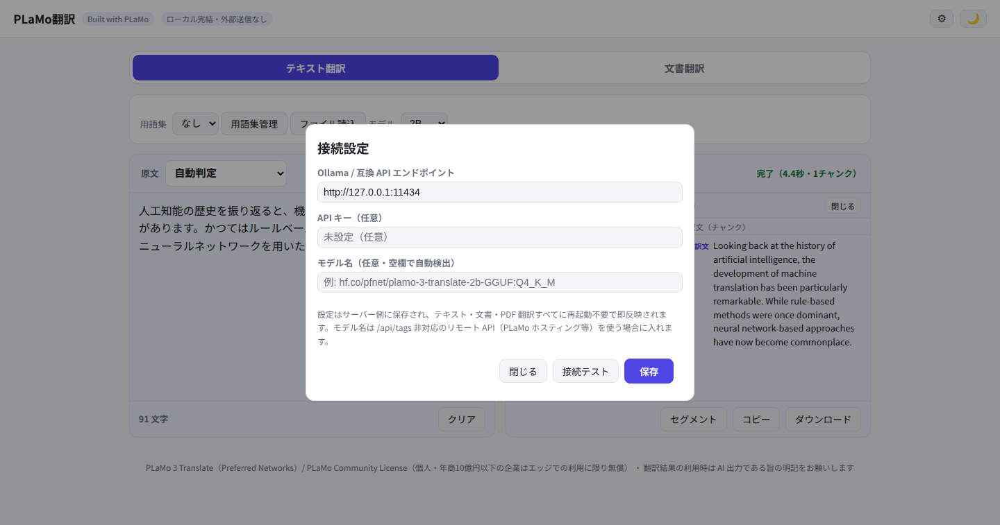

# PLaMo Local Translate

[日本語](README.md) | [English](README.en.md)

> ⚠️ 本プロジェクトは**非公式**の個人開発プロジェクトで、株式会社Preferred Networks とは一切関係ありません。PLaMo / PLaMo 3 Translate は Preferred Networks の名称（商標）です。

**[PLaMo 3 Translate](https://huggingface.co/pfnet/plamo-3-translate-2b-GGUF) + Ollama で動く、自分のマシンに自分で入れてローカル完結で使う翻訳サービス。**（llama.cpp / LM Studio も可 → [バックエンドの選択肢](#バックエンドの選択肢)）
主眼は **DeepL 文書翻訳風の「レイアウト保持翻訳」** — Word / PowerPoint / Excel / PDF / Markdown / HTML を書式そのまま翻訳し、翻訳前後の見た目プレビューや原文⇄訳文の対照表示ができます。**データは、自分でリモート API を指定しない限り、あなたのマシンから一歩も出ません。**

## 機能
- **テキスト翻訳**: 53 言語、HTML/Markdown のタグ構造を保持、長文はチャンク分割してストリーミング表示、チャンク単位の原文⇄訳文対照ビュー
- **文書翻訳**: `.docx` `.pptx` `.xlsx`（書式保持で書き戻し）/ `.pdf`（BabelDOC 統合・レイアウト保持）/ `.md` `.html` `.txt`（デリミタ保持）
- **見た目プレビュー**: LibreOffice + poppler で翻訳前後のページ画像を並べて比較、ズーム対応
- **翻訳前プレビュー**: 翻訳する前に抽出セグメントや PDF ページ画像を確認
- 用語集（複数保存可）・敬体/常体・⇄言語スワップ・プログレスバー・セッション内翻訳履歴
- **接続設定画面（⚙）**: バックエンドの URL・API キー・モデル名を WebUI から変更可能。サーバー側に保存され、再起動不要で即反映。**Ollama（推奨）のほか llama.cpp（llama-server）・LM Studio・リモートの OpenAI 互換 PLaMo API も使える**（[バックエンドの選択肢](#バックエンドの選択肢)参照）
- **軽量**: 翻訳モデルは GGUF Q4_K_M 量化で 0.8B ≈ 0.57 GB・2B ≈ 1.8 GB。専用GPU不要で、一般的なノートPCでも軽快に動く設計（→ [軽量 — 普通のノートPCで動く](#軽量--普通のノートpcで動く)）
- ライト/ダークテーマ、モバイル対応

## スクリーンショット

| テキスト翻訳 | 翻訳後の原文⇄訳文対照 |
|---|---|
|  |  |

| 見た目プレビュー（翻訳前後） | PDF 翻訳前プレビュー |
|---|---|
|  |  |

| Office（PowerPoint）翻訳の見た目プレビュー（原文 ⇄ 訳文） | Office（PowerPoint）翻訳後の原文⇄訳文対照（hover ハイライト） |
|---|---|
|  |  |

上の 2 枚は日本語の PowerPoint（表入り）を実際に英語へ翻訳したものです。Word / PowerPoint / Excel / PDF / Markdown / HTML が同じフロー（投入 → プレビュー → 翻訳 → 対照／見た目プレビュー → ダウンロード）で扱えます。

| 接続設定ダイアログ（⚙） |
|---|
|  |

## 軽量 — 普通のノートPCで動く

翻訳モデル PLaMo 3 Translate は 0.8B / 2B / 8B / 31B の 4 サイズ展開で、PFN は公式に「小型モデルはネットへの接続なしでもスマートフォンやノートパソコン、ウェアラブルデバイスなどで高速に動作し、即時的に訳文が得られる」「大規模計算環境がなくても高品質の訳文が手元で得られる」と述べています（[公式プレスリリース](https://www.preferred.jp/ja/news/pr20261105/)、PFN 比較評価で最小モデルが既存の翻訳特化 LLM を上回るスコア）。

- **GGUF Q4_K_M の実ファイルサイズ（Hugging Face 実測）**: 0.8B ≈ 0.57 GB、2B ≈ 1.8 GB。専用GPUは不要で、最近のノートPC（CPU のみ・RAM 8 GB クラス）なら 0.8B / 2B が現実的な選択肢です
- **参考: 実測（AMD Strix Halo 機・ノートPC 実測ではない）**: 0.8B ≈ 255 tok/s、8B ≈ 26 tok/s（2B はその中間）

> 当リポジトリではノートPCでの速度実測は行っていません。上記は出典を明記した参考値です。既定モデルは 2B（品質と速度のバランス）、さらに軽くなければならない環境では ⚙ で 0.8B に切り替えられます。

## クイックスタート

前提は **Ollama（推奨）**。llama.cpp / LM Studio を使う場合は[バックエンドの選択肢](#バックエンドの選択肢)を参照してください。

```bash
# 1. リポジトリをクローン
git clone https://github.com/keima-tech/plamo-translate.git
cd plamo-translate

# 2. Ollama を起動し、モデルを取得
ollama pull hf.co/pfnet/plamo-3-translate-2b-GGUF:Q4_K_M

# 3.（任意）設定: .env をコピーして編集、または起動後に WebUI の ⚙ から
cp .env.example .env

# 4. 起動
docker compose up -d --build
# → http://127.0.0.1:9130/
```

## バックエンドの選択肢

アプリは OpenAI 互換の `<URL>/v1/chat/completions` を呼ぶだけで、バックエンドは ⚙ 設定から**再起動不要**で切り替えられます。

| バックエンド | モデル自動検出 | モデル名の明示指定 | API キー |
|---|---|---|---|
| **Ollama**（推奨） | ✅ `/api/tags` | 不要 | 不要 |
| **llama.cpp**（llama-server） | △ `/api/tags` 非対応のため `/v1/models` へフォールバック（モデル名か `--alias` に `plamo-3-translate` を含めば自動検出可） | 推奨 | 不要 |
| **LM Studio**（Local Server） | △ 同上（**実機未検証**） | 要 | 不要（要求されたら任意の値） |

### Ollama（推奨・自動検出）

```bash
ollama pull hf.co/pfnet/plamo-3-translate-2b-GGUF:Q4_K_M
# 8B / 0.8B バリアントも自動検出される
```

同一マシンで動かすなら設定は不要（既定で `http://127.0.0.1:11434` に接続）。別マシンの Ollama を使う場合は ⚙ で URL だけ変えます。

### llama.cpp（llama-server）

Hugging Face から GGUF を取得して `llama-server` を起動します（コマンドは[公式モデルカード](https://huggingface.co/pfnet/plamo-3-translate-2b-GGUF)の例に準拠）。

```bash
# 1. GGUF を取得（Q4_K_M が既定推奨。0.8B/2B/8B/31B あり）
hf download pfnet/plamo-3-translate-2b-GGUF --local-dir plamo-3-translate-2b-GGUF

# 2. サーバー起動（-c はコンテキスト長、--port/--alias は環境に合わせて変更）
llama-server -m plamo-3-translate-2b-GGUF/plamo-3-translate-2b-Q4_K_M.gguf \
  -c 16384 --port 8080 --alias plamo-3-translate --jinja --no-prefill-assistant
```

アプリの ⚙ 設定で **エンドポイントに `http://<host>:8080`**、**モデル名に `plamo-3-translate`**（`--alias` の値）を指定して保存します。

- llama-server は Ollama の `/api/tags` を持たないため、アプリは `/v1/models` へフォールバックしてモデル一覧を取ります。一覧の名前に `plamo-3-translate` を含めば自動検出も動きますが、**モデル名の明示指定が安全**です
- **`plamo3` アーキテクチャに対応した比較的新しい llama.cpp ビルドが必要です**。古いビルドでは `unknown tokenizer: 'plamo3'` で起動に失敗します（実測例: Debian パッケージ版 b8681 は失敗、master 自前ビルドは成功）。`-c`・`--jinja` 等のフラグ詳細はモデルカードを参照してください

### LM Studio

LM Studio で Local Server を起動します（既定で `http://localhost:1234`、OpenAI 互換）。アプリの ⚙ 設定で**エンドポイントに `http://<host>:1234`**、**モデル名に読み込んだモデルの識別子**（例: `plamo-3-translate-2b`）を指定します。

> **注**: LM Studio は Linux サーバーでは通常動かないため、この導線は**実機未検証**です。公式モデルカードに記載の OpenAI 互換性（`/v1/chat/completions`・`/v1/models`）に基づく手順です。

## 設定

| 出典 | 優先度 | 備考 |
|---|---|---|
| WebUI ⚙ → `data/config.json` | 最高 | エンドポイント URL・API キー・モデル名の上書き。リクエスト毎に反映（再起動不要） |
| `.env` / 環境変数（`OLLAMA_URL`、`PORT`、`DATA_DIR`、`PDF_TIMEOUT_SECS`） | 既定 | `.env.example` 参照 |

- `GET /api/config` はマスク済みビューを返す（`api_key_masked` = 末尾 4 桁のみ。平文キーは絶対に返さない）
- `PUT /api/config` は `api_key` 空欄で既存キーを維持、`"__CLEAR__"` で消去
- `POST /api/config/test` は保存済み設定で接続テスト（`/api/tags` を試し、失敗時 `/v1/models` へフォールバック）
- `model` を明示すると自動検出を上書き — `/api/tags` 非対応のバックエンド（llama.cpp・LM Studio・リモート API）でもこれで動く

## ⚠ セキュリティ注意
既定では uvicorn が `127.0.0.1` にバインドし、**自分のマシンで自分だけ使う**設計です。ただし接続設定（⚙）は**認証なしで誰でも変更できます**。LAN の他端末と共有したり、信頼できないネットワークにリーチできるようにする場合は、nginx 等のリバースプロキシで Basic Auth など認証を必ず噛ませてください。API キーはサーバー側の `data/config.json`（権限 0600）に平文保存され、API レスポンスにはマスク（末尾 4 桁）のみ返されます。

## アーキテクチャ

```
app/
  main.py            FastAPI バックエンド（翻訳 API・用語集・文書翻訳・
                     BabelDOC shim・接続設定 API）
  doctrans.py        Office/md/html の抽出と書き戻し
  static/index.html   単一ファイルのフロントエンド（外部 CDN なし）
tests/               純関数＋設定 API テスト（素の pytest で実行）
docker-compose.yml   host network; uvicorn は 127.0.0.1:9130 にバインド
Dockerfile           python:3.12-slim + LibreOffice + poppler + Noto CJK（約 1.6 GB）
```

PDF 翻訳は BabelDOC をアプリ内蔵の OpenAI 互換 shim に対してサブプロセスで実行し、shim が汎用プロンプトを PLaMo 3 Translate が実際に理解する `[plamo-translate]` 形式へ書き換えます。

## 開発

```bash
pip install fastapi httpx python-multipart markdown python-docx python-pptx openpyxl pytest
pytest tests/ -v
```

CI（GitHub Actions）は push/PR ごとにこのテストを実行します。Docker イメージのビルドは LibreOffice 由来の時間・サイズ問題で CI では意図的に省略し、ローカルで検証しています。

## モデルライセンス
このリポジトリの**コードは MIT**（`LICENSE` 参照）ですが、**PLaMo 3 Translate モデル重みは [PLaMo Community License](https://plamo.preferredai.jp/info/plamo-community-license-ja)** のもとで公開されています：**直近事業年度の収入または売上が 10 億円以下の企業および個人は、商用・非商用にかかわらず、スマートフォン・ノートパソコン・社内サーバーなどのエッジでクラウドを介さずに無償利用できます**。この範囲を超える利用（クラウド経由の提供や売上規模が上限を超える場合など）は PFN との商用ライセンス契約が必要です。重みは [Hugging Face](https://huggingface.co/pfnet/plamo-3-translate-2b-GGUF) 等から各自の同意のもと取得してください。翻訳結果を利用する際は AI 出力である旨の明記を。

## 既知の限界
- スキャン PDF は OCR 未対応（テキストベース PDF のみ）
- LibreOffice 経由の見た目プレビューは再現度が元アプリと完全一致ではない
- 対照ビューはチャンク/セグメント単位（文単位ではない）
- 翻訳成果物は 2 時間後に自動削除
